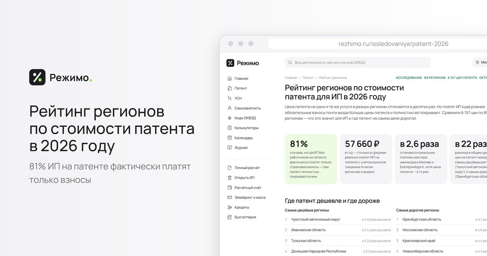

# Стоимость патента для ИП по регионам России, 2026

Открытый набор данных: рейтинг 89 регионов России по стоимости патента (ПСН) на 2026 год и цены патента по 10 самым популярным видам деятельности. Рейтинг построен на 6 156 ценах из калькулятора ФНС.

Интерактивная версия, рейтинг и методика: **https://rezhimo.ru/issledovaniya/patent-2026**

## Файлы

| Файл | Строк | Что внутри |
|---|---|---|
| `regions.csv` | 89 | Рейтинг регионов: место, индекс цены, доля видов, где взносы покрывают патент, медиана реального платежа |
| `popular-kinds.csv` | 881 | Цена патента по 10 популярным видам деятельности в каждом регионе: парикмахерские услуги, репетиторство, ремонт квартир, электромонтаж и сантехника, фотоуслуги, автосервис, ремонт техники, пошив одежды, ремонт мебели, присмотр за детьми. Место региона по цене и покрывают ли взносы патент |

Формат: CSV, UTF-8 с BOM, разделитель `;` (открывается в Excel двойным щелчком).

## Главное

- 81% видов деятельности: ИП без работников фактически платит только страховые взносы — цена патента их не превышает.
- Медиана реального платежа ИП без работников — 57 660 ₽ в год.
- Самый дешёвый регион по индексу — Чукотский АО, самый дорогой — Оренбургская область.
- Москва — 84-е место из 89.

## Методика

- **Источник цен** — калькулятор ФНС России (patent.nalog.ru), административный центр региона, ИП без наёмных работников, срок 12 месяцев, 2026 год. В районах региона патент может стоить дешевле.
- **Сопоставимость** — учтены только цены без территориальных и численных особенностей, установленные для ИП без работников.
- **Индекс региона** — медиана отношений цен региона к медианам по России по видам деятельности, которые есть не менее чем в 60 регионах. 1 = медиана по стране.
- **Реальный платёж** — что больше: цена патента или страховые взносы ИП за себя (57 390 ₽ + 1% с потенциального дохода свыше 300 000 ₽). ИП без работников уменьшает патент на всю сумму взносов.
- **«Взносы покрывают патент»** — патент к доплате после уменьшения на взносы равен нулю.

Данные обновлены: октябрь 2026. Цены по всем видам деятельности и калькулятор патента для любого региона — на https://rezhimo.ru/patent

## Лицензия

[CC BY 4.0](https://creativecommons.org/licenses/by/4.0/deed.ru). Можно использовать свободно, в том числе в СМИ и коммерческих проектах, при условии ссылки на источник:

> Источник: Режимо, rezhimo.ru/issledovaniya/patent-2026

## О проекте

[Режимо](https://rezhimo.ru) — бесплатный сервис, который помогает ИП и самозанятым выбрать налоговый режим: цены патента по всем регионам, калькуляторы УСН и взносов, налоговый календарь.

---

## English

**Patent tax (PSN) prices for sole proprietors in Russia, 2026.** Regional cost index for all 89 Russian regions (built on 6,156 Federal Tax Service calculator prices) and prices for the 10 most popular activity types. Semicolon-separated UTF-8 CSV. License: CC BY 4.0 — attribution: Rezhimo, https://rezhimo.ru/issledovaniya/patent-2026
